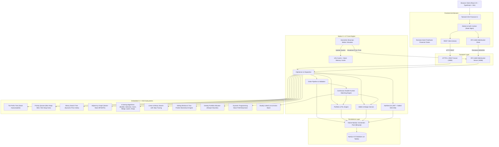

# TradeX — Smart Trading. Simulated. Data Driven.

[](https://isocpp.org/)
[](https://www.mysql.com/)
[](https://react.dev/)
[](https://www.typescriptlang.org/)
[](https://tailwindcss.com/)
[](LICENSE)

> **Important Educational Disclaimer:**  
> TradeX is an educational paper-trading and stock market simulation platform created as a computer science capstone project. It does **NOT** execute real financial orders, accept real money, or connect to live brokerage accounts. All financial values, order books, and prices are simulated.

---

## 1. System Overview

TradeX is an institutional-grade, full-stack stock trading simulation platform modeled after the workflow and information architecture of modern Indian discount brokerages (such as Zerodha Kite), featuring an original product identity and user interface.

Unlike typical web projects that implement simplified CRUD logic in Python or Node.js, **TradeX implements its entire financial exchange engine, order matching pipeline, and core Data Structures and Algorithms natively in modern C++17**.

---

## 2. Technical Architecture



---

## 3. Data Structures & Algorithms (DSA) in C++

TradeX features deep algorithmic integration with practical financial use cases. All algorithms are visually demonstrable in real-time on the **DSA Lab** page (`/dsa-lab`).

| # | Data Structure / Algorithm | C++ Class / File | Time Complexity | Space Complexity | Practical Application |
|---|---|---|---|---|---|
| **1** | **Prefix Tree (Trie)** | `Trie.hpp` | Search: $O(L)$, Insert: $O(L)$ | $O(\Sigma \cdot L \cdot N)$ | Instant stock symbol autocomplete without database table scans |
| **2** | **Priority Queue (Binary Heaps)** | `OrderBook.hpp` | Push: $O(\log N)$, Top: $O(1)$, Pop: $O(\log N)$ | $O(N)$ | Continuous Double-Auction matching (highest bid, lowest ask) |
| **3** | **Binary Search Tree (BST)** | `BST.hpp` | Search/Insert: $O(\log N)$ avg | $O(N)$ | Dynamic price ladder indexing and ascending Inorder traversals |
| **4** | **Adjacency List Graph (BFS/DFS)** | `MarketGraph.hpp` | $O(V + E)$ | $O(V + E)$ | Sector-equity contagion analysis and cluster exploration |
| **5** | **Sorting Suite (6 Algorithms)** | `SortingAlgorithms.hpp` | $O(N \log N)$ to $O(N^2)$ | $O(1)$ to $O(N)$ | Benchmarking order execution queues and trade tape sorting |
| **6** | **Search Suite (Linear & Binary)** | `SearchingAlgorithms.hpp` | $O(N)$ vs $O(\log N)$ | $O(1)$ | Comparative benchmark of price lookup in sorted arrays |
| **7** | **Sliding Window & Two-Pointer** | `MarketAnalyticsService.hpp` | $O(N)$ | $O(1)$ | Momentum analysis: longest streak and best growth period |
| **8** | **Greedy Capital Allocator** | `GreedyPortfolioService.hpp` | $O(N \log N)$ | $O(N)$ | Sharpe-ratio heuristic fractional/integer capital distribution |
| **9** | **Dynamic Programming (DP)** | `DynamicProgrammingService.hpp` | $O(N)$ to $O(K \times N)$ | $O(K \times N)$ | Optimal buy-sell execution with 1, unlimited, and $K$ trades |
| **10** | **Doubly Linked List & Stack** | `LinkedList.hpp`, `Stack.hpp` | Insert/Delete: $O(1)$ | $O(N)$ | Zero-allocation audit logging and action undo simulation |

---

## 4. Key Platform Features

- **Authentication & Security:** Salted SHA-256 password hashing, RFC-7519 JSON Web Tokens (JWT), role-based authorization (`USER` vs `ADMIN`).
- **Live Market Ticker:** Top banner displaying NIFTY 50, BANK NIFTY, SENSEX, and flashing equities animated via WebSocket price updates.
- **Stock Directory & Screener:** 32 top Indian equities across IT, Banking, Energy, FMCG, Auto, Pharma, Metals, and Telecom with sector filter chips and instant sort.
- **Interactive Price Charts:** High-performance vector charts with 1D, 1W, 1M, 6M, 1Y, and 5Y timeframe toggles using Recharts.
- **Market Depth Ladder (Order Book):** 5-depth Level 2 quotes backed by native C++ priority queues.
- **Order Processing & Brokerage Engine:**
  - Product: CNC (Delivery) or MIS (Intraday).
  - Order Types: MARKET, LIMIT, STOP_LOSS.
  - Realistic Indian charge estimation: Flat ₹20 / 0.03% brokerage, STT (0.1%), exchange txn fee (0.00345%), GST (18%), stamp duty (0.015%).
- **Portfolio & P&L Engine:** Realized and unrealized P&L calculations, automated ledger updates.
- **Virtual Funds & Wallet:** Instant simulated deposits and withdrawals with complete audit history and CSV export.
- **Interactive DSA Laboratory:** 10 visual tabs enabling interactive inspection and benchmarking of all C++ algorithms.
- **Admin Console:** Live market volatility controls, simulator pause/resume, and user account management.

---

## 5. Quickstart Guide

### Demo Credentials
| Account Role | Username | Password | Virtual Capital |
|---|---|---|---|
| **Standard Trader** | `trader` | `trader123` | ₹1,00,000 |
| **System Administrator** | `admin` | `admin123` | ₹5,00,000 |

*(Quick demo autofill buttons are built directly into the login screen).*

---

### Local Installation (Windows)

#### 1. Prerequisites
- **MySQL 8.0** running on `localhost:3306` with user `root` and password `Shivam@20` (or configured in `.env`).
- **LLVM-MinGW Clang++** or MSVC with C++17 support.
- **Node.js 18+** and npm.

#### 2. Database Initialization
```powershell
mysql -u root -p < database/schema.sql
mysql -u root -p tradex < database/indexes.sql
mysql -u root -p tradex < database/seed.sql
```

#### 3. Compile & Run the C++ Backend Daemon
```powershell
cd backend
clang++ -std=c++17 -O2 -Iinclude -I"C:\Program Files\MySQL\MySQL Server 8.0\include" -L"C:\Program Files\MySQL\MySQL Server 8.0\lib" -lmysql -lws2_32 src/main.cpp -o tradex_server.exe
.\tradex_server.exe
```
The server starts listening on `http://localhost:8080`.

#### 4. Run the Frontend Dashboard
```powershell
cd frontend
npm install
npm run dev
```
Open [http://localhost:5173](http://localhost:5173) in your browser.

---

### Docker Compose Deployment (Single Command)

```bash
docker-compose up --build -d
```
Access the web dashboard at `http://localhost:5173`.

---

## 6. Testing & Quality Assurance

### Run C++ DSA Unit Tests
```powershell
cd backend
clang++ -std=c++17 -O2 -Iinclude tests/test_dsa.cpp -o test_dsa.exe
.\test_dsa.exe
```
*Output: All 9 test suites pass with 100% assertions.*

### Run Python End-to-End Acceptance Test
```powershell
python tests/acceptance_test.py
```
*Output: Verifies JWT login, Trie autocomplete, Buy/Sell execution, balance deduction, and all 10 DSA Lab endpoints.*

---

## 7. BTech Viva / Defense Q&A

### Q1: Why use C++ instead of Python or Node.js for the trading backend?
**Answer:** Real-world trading engines require deterministic sub-microsecond latency, zero garbage collection pauses, and direct hardware memory layout control. Implementing the matching engine in C++ allows us to use cache-friendly contiguous data structures, inline priority queues, and multi-threaded Winsock2 sockets without interpreter overhead.

### Q2: How does the Continuous Double Auction matching engine work?
**Answer:** The matching engine maintains two heaps for every instrument: a Max-Heap for Bids (highest buy price has priority) and a Min-Heap for Asks (lowest sell price has priority), with order timestamps as FIFO tie-breakers. A trade executes whenever $\text{Best Bid Price} \ge \text{Best Ask Price}$. Orders are matched greedily at the resting order's price until quantities are satisfied.

### Q3: Why is a Trie superior to a SQL `LIKE '%query%'` query for symbol search?
**Answer:** A SQL `LIKE '%query%'` requires a full table scan ($O(N \cdot M)$ where $N$ is row count and $M$ is string length), creating database connection bottlenecks on every keystroke. A Prefix Trie locates the search root in $O(L)$ time (where $L$ is prefix length) and retrieves $K$ suggestions via Depth-First Search in $O(L + K)$ time directly from RAM in microseconds.

### Q4: How is data consistency guaranteed during order placement?
**Answer:** Order execution involves atomic state transitions across multiple entities: validating margin, reserving funds in `wallet`, updating `orders`, appending an immutable record in `transactions`, and adjusting `holdings`. These steps are protected by mutex synchronization in C++ and wrapped within MySQL database transactions (`BEGIN ... COMMIT / ROLLBACK`) to prevent race conditions or negative balances.

### Q5: How does TradeX handle fragmented TCP packets in C++?
**Answer:** HTTP requests over TCP can arrive fragmented across multiple `recv()` calls. `HttpServer::handleClient` inspects the initial header buffer to extract the `Content-Length` header, calculates the expected total byte count (`header_length + content_length`), and executes a loop accumulating socket chunks until the full payload has arrived before passing it to the JSON parser.

---

## 8. Documentation Index

- [System Architecture](docs/architecture.md)
- [Database & ER Model](docs/database.md)
- [REST & WebSocket API Guide](docs/api.md)
- [Data Structures & Algorithms Specification](docs/dsa.md)
- [Trading & Mathematical Algorithms](docs/algorithms.md)
- [Security & Compliance](docs/security.md)
- [Testing & Quality Assurance](docs/testing.md)
- [Deployment Guide](docs/deployment.md)
- [User Journey & Workflow](docs/user-flow.md)

---

## 9. License

This project is licensed under the MIT License. Built for educational and academic purposes.
