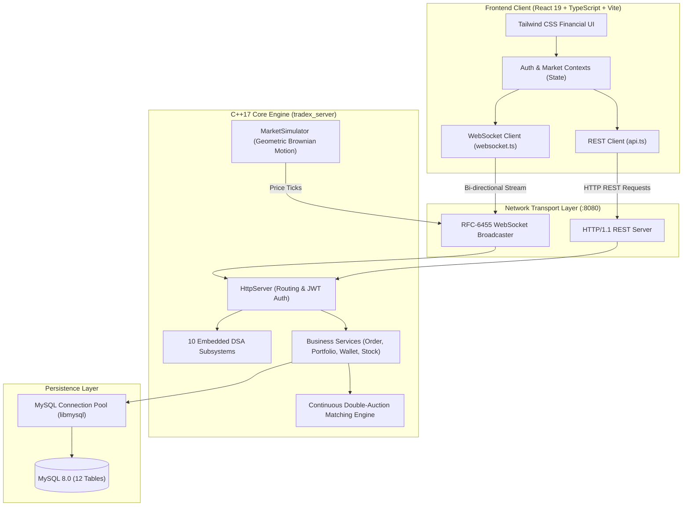

# TradeX — System Summary & Frontend Connection Map

> **TradeX** is an institutional-grade, simulated stock trading platform and financial exchange engine.  
> It pairs a modern **React 19 + TypeScript** frontend with a high-performance **C++17 multi-threaded engine** and a **MySQL 8.0** persistence layer.

---

## 1. System Architecture Overview



---

## 2. Quick File-by-File Summary & Frontend Connections

### A. Frontend Layer (`frontend/src/`)

| File Path | Role & Purpose | Frontend / Backend Connection |
|---|---|---|
| [`main.tsx`](file:///d:/course_projects/DS-1/frontend/src/main.tsx) | Application entrypoint; mounts React 19 tree. | Injects `<App />` and global styles into `#root`. |
| [`App.tsx`](file:///d:/course_projects/DS-1/frontend/src/App.tsx) | Primary router (`react-router-dom`), layout, route protection. | Wraps application with `AuthProvider` & `MarketProvider`; mounts navigation and `<OrderModal />`. |
| [`index.css`](file:///d:/course_projects/DS-1/frontend/src/index.css) / [`App.css`](file:///d:/course_projects/DS-1/frontend/src/App.css) | Global styling and green/red flash animations. | Drives price tick flash transitions (`.flash-green`, `.flash-red`) triggered by WebSocket updates. |
| [`types/index.ts`](file:///d:/course_projects/DS-1/frontend/src/types/index.ts) | TypeScript definitions (User, Stock, Order, DSA types). | Ensures compile-time type consistency across all UI components and API payloads. |
| [`services/api.ts`](file:///d:/course_projects/DS-1/frontend/src/services/api.ts) | Axios HTTP client with JWT interceptor. | Dispatches requests to `/api/v1/*` routes on the C++ backend. |
| [`services/websocket.ts`](file:///d:/course_projects/DS-1/frontend/src/services/websocket.ts) | RFC-6455 WebSocket client with auto-reconnection. | Streams real-time ticks (`PRICE_TICK`) and order alerts (`ORDER_UPDATE`) into `MarketContext`. |
| [`context/AuthContext.tsx`](file:///d:/course_projects/DS-1/frontend/src/context/AuthContext.tsx) | Global authentication & role management (`USER`/`ADMIN`). | Manages login state, JWT tokens in `localStorage`, and role-based access. |
| [`context/MarketContext.tsx`](file:///d:/course_projects/DS-1/frontend/src/context/MarketContext.tsx) | Live market state, stock map, price flash triggers. | Subscribes to `wsClient`, updating live quotes across all pages and components without full re-renders. |

### B. Frontend Components & Pages

| Component / Page | Purpose | How It Connects to Frontend & Backend |
|---|---|---|
| [`Navbar.tsx`](file:///d:/course_projects/DS-1/frontend/src/components/Navbar.tsx) | Navigation header, notifications tray, user profile. | Contains **Trie Autocomplete Search Box** connected to `/api/v1/stocks/search?q=...`. |
| [`Sidebar.tsx`](file:///d:/course_projects/DS-1/frontend/src/components/Sidebar.tsx) | Terminal sidebar navigation. | Routes between pages; conditionally shows Admin Console if user is admin. |
| [`MarketTicker.tsx`](file:///d:/course_projects/DS-1/frontend/src/components/MarketTicker.tsx) | Live index banner (NIFTY, SENSEX) and equities. | Animated by WebSocket ticks stored in `MarketContext`. |
| [`OrderModal.tsx`](file:///d:/course_projects/DS-1/frontend/src/components/OrderModal.tsx) | Buy/Sell order execution dialog. | Calculates brokerage/statutory taxes; submits orders to `/api/v1/orders`. |
| [`OrderBook.tsx`](file:///d:/course_projects/DS-1/frontend/src/components/OrderBook.tsx) | Level-2 Market Depth ladder. | Polls `/api/v1/dsa/orderbook/:symbol` backed by C++ Max/Min Heaps. |
| [`PriceChart.tsx`](file:///d:/course_projects/DS-1/frontend/src/components/PriceChart.tsx) | Recharts interactive multi-timeframe chart. | Fetches historical OHLCV data from `/api/v1/stocks/:symbol/history?range=...`. |
| [`PortfolioSummary.tsx`](file:///d:/course_projects/DS-1/frontend/src/components/PortfolioSummary.tsx) | 4-card metric overview (Invested, Value, P&L). | Consumes data from `Portfolio.tsx` and `Dashboard.tsx`. |
| [`HoldingsTable.tsx`](file:///d:/course_projects/DS-1/frontend/src/components/HoldingsTable.tsx) | Equity delivery (CNC) holdings table. | Recalculates live P&L using real-time prices from `MarketContext`. |
| [`PositionsTable.tsx`](file:///d:/course_projects/DS-1/frontend/src/components/PositionsTable.tsx) | Intraday (MIS) open positions table. | Tracks realized and unrealized P&L; allows 1-click square-off. |
| [`Dashboard.tsx`](file:///d:/course_projects/DS-1/frontend/src/pages/Dashboard.tsx) | Main trader home screen. | Integrates `PortfolioSummary`, `PriceChart`, `OrderBook`, and Market Movers. |
| [`Markets.tsx`](file:///d:/course_projects/DS-1/frontend/src/pages/Markets.tsx) | Stock directory & screener across 8 sectors. | Displays all 32 stocks with real-time flashing prices and quick Buy/Sell triggers. |
| [`StockDetail.tsx`](file:///d:/course_projects/DS-1/frontend/src/pages/StockDetail.tsx) | In-depth equity view for `/stocks/:symbol`. | Combines chart, market depth ladder, quote metrics, and trade controls. |
| [`Watchlists.tsx`](file:///d:/course_projects/DS-1/frontend/src/pages/Watchlists.tsx) | Custom watchlists management. | CRUD operations on watchlists via `/api/v1/watchlists`. |
| [`Orders.tsx`](file:///d:/course_projects/DS-1/frontend/src/pages/Orders.tsx) | Open, executed, and cancelled orders ledger. | Fetches orders from `/api/v1/orders`; supports cancelling resting limit orders. |
| [`Portfolio.tsx`](file:///d:/course_projects/DS-1/frontend/src/pages/Portfolio.tsx) | Portfolio management view. | Tabs between `HoldingsTable` (CNC) and `PositionsTable` (MIS). |
| [`Funds.tsx`](file:///d:/course_projects/DS-1/frontend/src/pages/Funds.tsx) | Virtual funds deposit and withdrawal terminal. | Calls `/api/v1/funds/deposit` and `/api/v1/funds/withdraw`; exports CSV statements. |
| [`Transactions.tsx`](file:///d:/course_projects/DS-1/frontend/src/pages/Transactions.tsx) | Complete cash flow and trade audit ledger. | Fetches trade and deposit ledger from `/api/v1/transactions`. |
| [`DsaLab.tsx`](file:///d:/course_projects/DS-1/frontend/src/pages/DsaLab.tsx) | 10 interactive visualizer tabs for DSA. | Connects directly to `/api/v1/dsa/*` endpoints to benchmark algorithms. |
| [`Admin.tsx`](file:///d:/course_projects/DS-1/frontend/src/pages/Admin.tsx) | Administrative control console. | Controls `MarketSimulator` start/stop and displays registered users. |
| [`Login.tsx`](file:///d:/course_projects/DS-1/frontend/src/pages/Login.tsx) / [`Register.tsx`](file:///d:/course_projects/DS-1/frontend/src/pages/Register.tsx) | Authentication views with 1-click demo logins. | Interacts with `/api/v1/auth/login` and `/api/v1/auth/register`. |
| [`Settings.tsx`](file:///d:/course_projects/DS-1/frontend/src/pages/Settings.tsx) | Profile preferences and API connection diagnostics. | Displays user session and system health info. |

---

### C. Backend C++ Core (`backend/`)

| File Path | Role & Purpose | Frontend Connection |
|---|---|---|
| [`main.cpp`](file:///d:/course_projects/DS-1/backend/src/main.cpp) | Daemon entrypoint: initializes DB pool, preloads stocks into Trie, starts simulator, launches server. | Starts port `:8080`, providing the REST and WebSocket endpoints for the frontend. |
| [`HttpServer.hpp`](file:///d:/course_projects/DS-1/backend/include/api/HttpServer.hpp) | Multi-threaded HTTP/1.1 REST router and RFC-6455 WebSocket broadcaster. | Direct receiver of all Axios requests from `api.ts` and WebSocket connections from `websocket.ts`. |
| [`Database.hpp`](file:///d:/course_projects/DS-1/backend/include/database/Database.hpp) | Thread-safe MySQL connection pool using `libmysql`. | Executes queries backing all user-facing data (balances, orders, portfolios). |
| [`Models.hpp`](file:///d:/course_projects/DS-1/backend/include/models/Models.hpp) | C++ domain structures (`User`, `Stock`, `Order`, `Holding`, etc.). | Serialized into JSON and mapped to TypeScript types in `frontend/src/types/index.ts`. |
| [`Crypto.hpp`](file:///d:/course_projects/DS-1/backend/include/utils/Crypto.hpp) | SHA-256 password hashing, HMAC-SHA256 JWT, WebSocket SHA-1 handshake. | Generates JWT tokens for `AuthContext` and completes the WebSocket opening handshake. |
| [`Json.hpp`](file:///d:/course_projects/DS-1/backend/include/utils/Json.hpp) | Header-only C++ JSON parser and serializer. | Decodes inbound frontend POST bodies and encodes outbound API responses. |
| [`AuthService.hpp`](file:///d:/course_projects/DS-1/backend/include/services/AuthService.hpp) | User registration, login, and JWT verification. | Backs `Login.tsx`, `Register.tsx`, and session validation in `AuthContext.tsx`. |
| [`StockService.hpp`](file:///d:/course_projects/DS-1/backend/include/services/StockService.hpp) | RAM stock inventory, Trie search, OHLCV history, market indices. | Feeds `Navbar.tsx` (autocomplete), `Markets.tsx`, `PriceChart.tsx`, and `Dashboard.tsx`. |
| [`OrderService.hpp`](file:///d:/course_projects/DS-1/backend/include/services/OrderService.hpp) | Order pipeline: margin check, Double-Auction matching, wallet & holding settlement. | Invoked when user submits an order in `OrderModal.tsx` or cancels in `Orders.tsx`. |
| [`PortfolioService.hpp`](file:///d:/course_projects/DS-1/backend/include/services/PortfolioService.hpp) | Consolidates holdings, open positions, and total P&L. | Feeds `portfolioApi.getPortfolio()` used by `PortfolioSummary`, `HoldingsTable`, `PositionsTable`. |
| [`WalletService.hpp`](file:///d:/course_projects/DS-1/backend/include/services/WalletService.hpp) | Virtual margin, deposits, withdrawals, and financial transactions. | Feeds `Funds.tsx`, `Transactions.tsx`, and available balance validation in `OrderModal.tsx`. |
| [`WatchlistService.hpp`](file:///d:/course_projects/DS-1/backend/include/services/WatchlistService.hpp) | Manages user watchlist groupings. | Powers the user-created watchlist lists in `Watchlists.tsx`. |
| [`MarketSimulator.hpp`](file:///d:/course_projects/DS-1/backend/include/services/MarketSimulator.hpp) | Background thread simulating price movements via Geometric Brownian Motion. | Generates the tick stream broadcast to `websocket.ts` and rendered in `MarketTicker.tsx`. |
| [`CacheService.hpp`](file:///d:/course_projects/DS-1/backend/include/services/CacheService.hpp) | In-memory LRU cache with eviction policy. | Caches frequent read queries (like price chart history) for fast frontend responses. |
| [`PnLService.hpp`](file:///d:/course_projects/DS-1/backend/include/services/PnLService.hpp) | Real-world Indian brokerage and tax calculation formulas. | Powers the real-time fee breakdown displayed in `OrderModal.tsx`. |

---

### D. Embedded C++ Data Structures & Algorithms (DSA Subsystem)

| Algorithm / Header | Big-O Complexity | Practical Financial Role | Frontend View |
|---|---|---|---|
| [`Trie.hpp`](file:///d:/course_projects/DS-1/backend/include/dsa/Trie.hpp) | $O(L)$ Search/Insert | Instant stock autocomplete without table scans | `Navbar.tsx` & `DsaLab.tsx` (Tab 1) |
| [`OrderBook.hpp`](file:///d:/course_projects/DS-1/backend/include/dsa/OrderBook.hpp) & [`MatchingEngine.hpp`](file:///d:/course_projects/DS-1/backend/include/dsa/MatchingEngine.hpp) | $O(\log N)$ Heap Push/Pop | Continuous Double-Auction matching (Max/Min Heaps) | `<OrderBook />` & `DsaLab.tsx` (Tab 2) |
| [`OrderQueue.hpp`](file:///d:/course_projects/DS-1/backend/include/dsa/OrderQueue.hpp) | $O(1)$ Enqueue/Dequeue | FIFO queue for orders with identical limit prices | Internal order execution order |
| [`BST.hpp`](file:///d:/course_projects/DS-1/backend/include/dsa/BST.hpp) | $O(\log N)$ Avg Search | Dynamic price ladder indexing and traversals | `DsaLab.tsx` (Tab 3) |
| [`MarketGraph.hpp`](file:///d:/course_projects/DS-1/backend/include/dsa/MarketGraph.hpp) | $O(V + E)$ Traversal | Sector-equity contagion analysis via BFS/DFS | `DsaLab.tsx` (Tab 4) |
| [`SortingAlgorithms.hpp`](file:///d:/course_projects/DS-1/backend/include/dsa/SortingAlgorithms.hpp) | $O(N \log N)$ to $O(N^2)$ | 6 sorting algorithms with step-by-step tracing | `DsaLab.tsx` (Tab 5) |
| [`SearchingAlgorithms.hpp`](file:///d:/course_projects/DS-1/backend/include/dsa/SearchingAlgorithms.hpp) | $O(N)$ vs $O(\log N)$ | Linear vs Binary search with pointer visualizer | `DsaLab.tsx` (Tab 6) |
| [`MarketAnalyticsService.hpp`](file:///d:/course_projects/DS-1/backend/include/dsa/MarketAnalyticsService.hpp) | $O(N)$ Time, $O(1)$ Space | Sliding Window best growth period & Two-Pointer streak | `DsaLab.tsx` (Tab 7) |
| [`GreedyPortfolioService.hpp`](file:///d:/course_projects/DS-1/backend/include/dsa/GreedyPortfolioService.hpp) | $O(N \log N)$ Sort/Alloc | Sharpe-ratio heuristic capital allocation | `DsaLab.tsx` (Tab 8) |
| [`DynamicProgrammingService.hpp`](file:///d:/course_projects/DS-1/backend/include/dsa/DynamicProgrammingService.hpp) | $O(N)$ to $O(K \times N)$ | Maximum profit optimization for 1, unlimited, or $K$ trades | `DsaLab.tsx` (Tab 9) |
| [`LinkedList.hpp`](file:///d:/course_projects/DS-1/backend/include/dsa/LinkedList.hpp) & [`Stack.hpp`](file:///d:/course_projects/DS-1/backend/include/dsa/Stack.hpp) | $O(1)$ Append/Pop | Zero-allocation audit logging and action undo tracking | `DsaLab.tsx` (Tab 10) |

---

### E. Database Layer (`database/`)

| File Path | Description | Connection to Frontend |
|---|---|---|
| [`schema.sql`](file:///d:/course_projects/DS-1/database/schema.sql) | DDL schema for MySQL 8.0: 12 tables with foreign key constraints. | Defines the schema for all data displayed and modified by the frontend. |
| [`indexes.sql`](file:///d:/course_projects/DS-1/database/indexes.sql) | Performance B-Tree indexes on emails, symbols, statuses, timestamps. | Guarantees sub-millisecond REST query responses to frontend requests. |
| [`seed.sql`](file:///d:/course_projects/DS-1/database/seed.sql) | Seed script inserting demo users, starter wallets, and 32 stocks. | Populates the initial demo dataset visible immediately on login. |

---

### F. Configuration, Testing & Deployment Files

| File Path | Description | Connection to Frontend |
|---|---|---|
| [`vite.config.ts`](file:///d:/course_projects/DS-1/frontend/vite.config.ts) | Vite dev config; sets up reverse proxy `/api` and `/ws` to `:8080`. | **Crucial Bridge:** Transparently forwards frontend API and WebSocket calls to C++ backend. |
| [`docker-compose.yml`](file:///d:/course_projects/DS-1/docker-compose.yml) | Multi-container setup for MySQL, C++ backend, and React frontend. | Spins up the entire full-stack ecosystem with a single command. |
| [`Dockerfile.frontend`](file:///d:/course_projects/DS-1/Dockerfile.frontend) | Builds production bundle and sets up Nginx with reverse proxy. | Serves the production UI on port 5173 / 80. |
| [`Dockerfile.backend`](file:///d:/course_projects/DS-1/Dockerfile.backend) | Multi-stage build compiling C++ code via `clang++` on Ubuntu. | Runs the containerized C++ backend daemon. |
| [`.env.example`](file:///d:/course_projects/DS-1/.env.example) | Environment variable template (database, ports, JWT secret). | Configures server parameters and simulation settings. |
| [`tests/acceptance_test.py`](file:///d:/course_projects/DS-1/tests/acceptance_test.py) | Python end-to-end integration test suite. | Simulates the exact frontend HTTP user journey (Login $\rightarrow$ Search $\rightarrow$ Buy $\rightarrow$ Sell $\rightarrow$ DSA Lab). |
| [`backend/tests/test_dsa.cpp`](file:///d:/course_projects/DS-1/backend/tests/test_dsa.cpp) | C++ unit test suite for all 10 DSA structures. | Verifies algorithmic correctness of backend logic powering the frontend. |

---

## 3. Core Interaction Flow: Order Placement to UI Update

```text
1. User clicks "BUY" on Markets/StockDetail page.
   │
2. MarketContext.openOrderModal(stock, 'BUY') displays OrderModal.tsx.
   │
3. OrderModal calculates brokerage + statutory charges (STT, GST, Stamp Duty).
   │
4. User clicks "Place Buy Order" -> orderApi.placeOrder() sends POST to /api/v1/orders.
   │
5. C++ HttpServer receives HTTP request, validates Bearer JWT token.
   │
6. OrderService checks margin in MySQL wallet table.
   │
7. MatchingEngine matches order using OrderBook Max-Heap (Bids) and Min-Heap (Asks).
   │
8. Database transaction updates wallet, inserts into orders, updates holdings, appends to transactions.
   │
9. HttpServer broadcasts WebSocket message: {"type": "ORDER_UPDATE", orderId, status: "EXECUTED"}.
   │
10. Frontend websocket.ts receives event; MarketContext & UI update balances and holdings table instantly.
```
