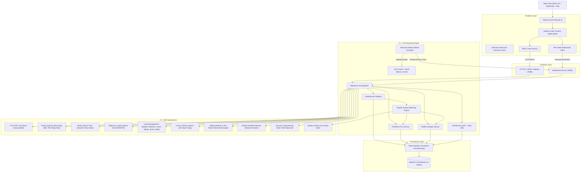
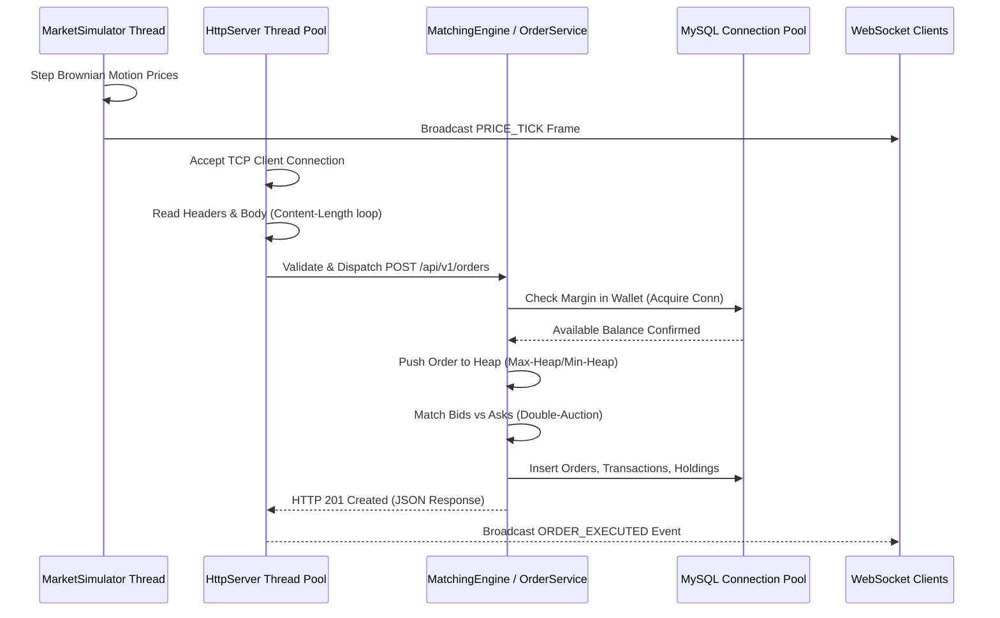

# TradeX System Architecture Specification

## 1. Executive Summary

**TradeX** is an enterprise-grade, full-stack educational paper-trading and stock market simulation platform modeled after modern institutional brokerage architectures. Built to demonstrate high-performance systems engineering, algorithmic trading concepts, and advanced Data Structures and Algorithms (DSA), TradeX pairs a low-latency native **C++17** backend engine with a **MySQL 8.0** relational persistence store and a modern **React 19 / TypeScript / Tailwind CSS** reactive web dashboard.

---

## 2. High-Level Architecture Diagram

---

## 3. Layer Breakdown

### 3.1 Presentation Layer (Frontend)
- **Framework:** React 19 with TypeScript, bundled with Vite 8.
- **Styling:** Tailwind CSS 4 with a dark fintech color scheme (slate-950 background, emerald-400 profit, rose-400 loss, blue-500 primary accents).
- **Charting:** Recharts SVG vector graphs with multi-timeframe toggles (1D, 1W, 1M, 6M, 1Y, 5Y), custom tooltips, and linear gradients.
- **Real-Time Data:** Persistent WebSocket connection receiving automated Brownian motion ticks, updating the centralized `MarketContext` and triggering CSS flash animations.

### 3.2 Native C++ Core Engine
- **Language Standard:** C++17 compiled via LLVM-MinGW Clang++ (x86_64).
- **Network I/O:** Multi-threaded Winsock2 socket server with thread pooling and non-blocking socket handling.
- **TCP Chunk Assembly:** Robust loop handling fragmented TCP transfers according to the `Content-Length` HTTP/1.1 standard.
- **WebSocket Protocol:** RFC-6455 compliant handshake with SHA-1 and Base64 Sec-WebSocket-Accept key generation, supporting unmasked server-to-client frame streaming.

### 3.3 Persistence Layer
- **RDBMS:** MySQL 8.0 Enterprise.
- **Database Driver:** Native `libmysql` C API linked dynamically (`libmysql.dll`).
- **Connection Pooling:** Thread-safe connection pool with automatic connection recycling and parameterized SQL statements to eliminate SQL injection.
- **Schema Design:** 12 3NF normalized tables with B-Tree indexes on lookup keys and foreign keys.

---

## 4. Concurrency & Threading Model

---

## 5. Security & Isolation Model
1. **Zero Real-World Broker Connectivity:** Educational sandbox with no live exchange or bank APIs.
2. **Password Cryptography:** Secure SHA-256 password hashing with user-specific salts; plain-text passwords are never stored.
3. **Stateless Authorization:** Cryptographic JSON Web Tokens (JWT) using HMAC-SHA256 signature verification on every protected endpoint.
4. **Role-Based Access Control (RBAC):** Strict separation between standard paper-trader accounts (`USER`) and simulation managers (`ADMIN`).
