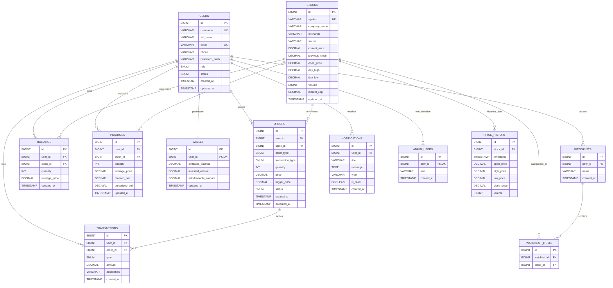

# TradeX Database Architecture & ER Specification

## 1. Overview
The TradeX persistence layer is implemented in **MySQL 8.0** using a strictly normalized **Third Normal Form (3NF)** relational schema across 12 distinct tables. All financial values (`price`, `balance`, `amount`, `pnl`) are modeled as `DECIMAL(15, 2)` or `DECIMAL(12, 2)` to eliminate IEEE-754 floating-point rounding errors in monetary operations.

---

## 2. Entity-Relationship (ER) Diagram

---

## 3. Table Definitions & Constraints

### 3.1 `users`
Primary identity and authentication store.
- `id`: BIGINT AUTO_INCREMENT PRIMARY KEY
- `username`: VARCHAR(50) NOT NULL UNIQUE
- `full_name`: VARCHAR(100) NOT NULL
- `email`: VARCHAR(100) NOT NULL UNIQUE
- `phone`: VARCHAR(20)
- `password_hash`: VARCHAR(255) NOT NULL (SHA-256 salted hash)
- `role`: ENUM('USER', 'ADMIN', 'SUPER_ADMIN') DEFAULT 'USER'
- `status`: ENUM('ACTIVE', 'SUSPENDED', 'PENDING') DEFAULT 'ACTIVE'
- `created_at`, `updated_at`: TIMESTAMP

### 3.2 `stocks`
Equities traded on simulated NSE and BSE exchanges.
- `id`: BIGINT AUTO_INCREMENT PRIMARY KEY
- `symbol`: VARCHAR(20) NOT NULL UNIQUE
- `company_name`: VARCHAR(100) NOT NULL
- `exchange`: VARCHAR(10) NOT NULL DEFAULT 'NSE'
- `sector`: VARCHAR(50) NOT NULL
- `current_price`: DECIMAL(12, 2) NOT NULL
- `previous_close`: DECIMAL(12, 2) NOT NULL
- `open_price`: DECIMAL(12, 2) NOT NULL
- `day_high`: DECIMAL(12, 2) NOT NULL
- `day_low`: DECIMAL(12, 2) NOT NULL
- `volume`: BIGINT NOT NULL DEFAULT 0
- `market_cap`: DECIMAL(18, 2) NOT NULL
- `updated_at`: TIMESTAMP

### 3.3 `wallet`
Virtual paper-trading cash balance and margin account.
- `id`: BIGINT AUTO_INCREMENT PRIMARY KEY
- `user_id`: BIGINT NOT NULL UNIQUE, FOREIGN KEY (`user_id`) REFERENCES `users`(`id`) ON DELETE CASCADE
- `available_balance`: DECIMAL(15, 2) NOT NULL DEFAULT 100000.00
- `invested_amount`: DECIMAL(15, 2) NOT NULL DEFAULT 0.00
- `withdrawable_amount`: DECIMAL(15, 2) NOT NULL DEFAULT 100000.00
- `updated_at`: TIMESTAMP

### 3.4 `orders`
Double-auction order records.
- `id`: BIGINT AUTO_INCREMENT PRIMARY KEY
- `user_id`: BIGINT NOT NULL, FOREIGN KEY (`user_id`) REFERENCES `users`(`id`) ON DELETE CASCADE
- `stock_id`: BIGINT NOT NULL, FOREIGN KEY (`stock_id`) REFERENCES `stocks`(`id`)
- `order_type`: ENUM('MARKET', 'LIMIT', 'STOP_LOSS') NOT NULL
- `transaction_type`: ENUM('BUY', 'SELL') NOT NULL
- `quantity`: INT NOT NULL CHECK (`quantity` > 0)
- `price`: DECIMAL(12, 2) NOT NULL
- `trigger_price`: DECIMAL(12, 2) DEFAULT 0.00
- `status`: ENUM('PENDING', 'EXECUTED', 'CANCELLED', 'REJECTED') DEFAULT 'PENDING'
- `created_at`, `executed_at`: TIMESTAMP

### 3.5 `holdings`
Delivery (CNC) equity portfolio holdings.
- `id`: BIGINT AUTO_INCREMENT PRIMARY KEY
- `user_id`: BIGINT NOT NULL, FOREIGN KEY (`user_id`) REFERENCES `users`(`id`) ON DELETE CASCADE
- `stock_id`: BIGINT NOT NULL, FOREIGN KEY (`stock_id`) REFERENCES `stocks`(`id`)
- `quantity`: INT NOT NULL CHECK (`quantity` >= 0)
- `average_price`: DECIMAL(12, 2) NOT NULL
- `updated_at`: TIMESTAMP
- `UNIQUE KEY` (`user_id`, `stock_id`)

### 3.6 `positions`
Intraday (MIS) trading positions with realized and unrealized P&L.
- `id`: BIGINT AUTO_INCREMENT PRIMARY KEY
- `user_id`: BIGINT NOT NULL, FOREIGN KEY (`user_id`) REFERENCES `users`(`id`) ON DELETE CASCADE
- `stock_id`: BIGINT NOT NULL, FOREIGN KEY (`stock_id`) REFERENCES `stocks`(`id`)
- `quantity`: INT NOT NULL DEFAULT 0
- `average_price`: DECIMAL(12, 2) NOT NULL DEFAULT 0.00
- `realized_pnl`: DECIMAL(15, 2) NOT NULL DEFAULT 0.00
- `unrealized_pnl`: DECIMAL(15, 2) NOT NULL DEFAULT 0.00
- `updated_at`: TIMESTAMP
- `UNIQUE KEY` (`user_id`, `stock_id`)

### 3.7 `transactions`
Double-entry immutable audit ledger of all cash flows.
- `id`: BIGINT AUTO_INCREMENT PRIMARY KEY
- `user_id`: BIGINT NOT NULL, FOREIGN KEY (`user_id`) REFERENCES `users`(`id`) ON DELETE CASCADE
- `order_id`: BIGINT NULL, FOREIGN KEY (`order_id`) REFERENCES `orders`(`id`) ON DELETE SET NULL
- `type`: ENUM('BUY', 'SELL', 'DEPOSIT', 'WITHDRAWAL') NOT NULL
- `amount`: DECIMAL(15, 2) NOT NULL
- `description`: VARCHAR(255) NOT NULL
- `created_at`: TIMESTAMP DEFAULT CURRENT_TIMESTAMP

### 3.8 `price_history`
Granular OHLCV candlestick time series for technical charts.
- `id`: BIGINT AUTO_INCREMENT PRIMARY KEY
- `stock_id`: BIGINT NOT NULL, FOREIGN KEY (`stock_id`) REFERENCES `stocks`(`id`) ON DELETE CASCADE
- `timestamp`: TIMESTAMP NOT NULL
- `open_price`, `high_price`, `low_price`, `close_price`: DECIMAL(12, 2) NOT NULL
- `volume`: BIGINT NOT NULL DEFAULT 0

---

## 4. Indexing Strategy (`indexes.sql`)
To ensure queries execute in sub-millisecond time:
- `idx_stocks_symbol`: Fast symbol resolution for Trie initialization and direct routing.
- `idx_stocks_sector`: Accelerates sector filtering across the Market directory.
- `idx_orders_user_status`: Composite index on `(user_id, status)` for fast retrieval of open pending orders.
- `idx_holdings_user`: Composite index on `(user_id, stock_id)` for $O(1)$ portfolio balance checks.
- `idx_price_history_stock_time`: Composite index on `(stock_id, timestamp DESC)` for fast historical chart window queries.
