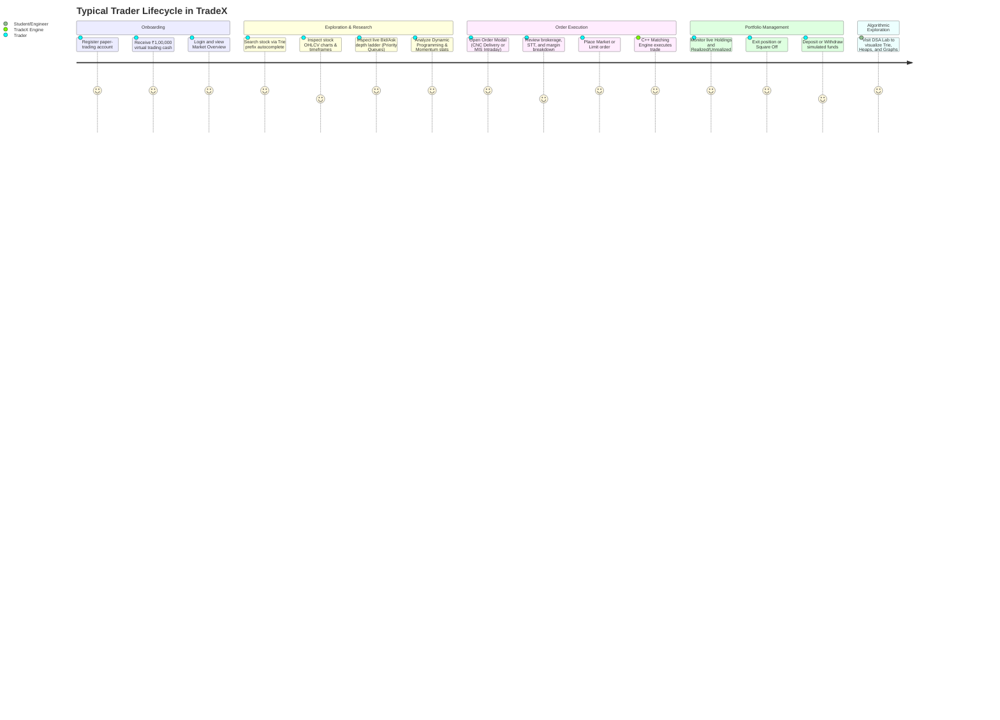

# TradeX User Flow & Trading Journey Specification

## 1. Journey Architecture

---

## 2. Detailed Step-by-Step Operations

### Step 1: Authentication & Account Initialization
1. Trader navigates to `/login` or `/register`.
2. Upon registration, the database transaction automatically provisions:
   - A row in `users`.
   - A row in `wallet` with `available_balance = 100000.00` and `invested_amount = 0.00`.
   - A default `watchlists` entry named "My Watchlist".
3. Trader receives an authentication JWT stored in localStorage.

### Step 2: Real-Time Market Overview & Stock Discovery
1. The top `MarketTicker` displays live indices (NIFTY 50, BANK NIFTY, SENSEX) and flashing stock price tickers.
2. In the top `Navbar` or on the `Markets` page, typing into the search bar triggers the C++ Trie prefix tree (`/stocks/search?q=...`), presenting matched results within 2 milliseconds.
3. Clicking on any stock opens the comprehensive `StockDetail` view.

### Step 3: Depth Ladder & Algorithmic Insights
1. The trader inspects the 5-depth Market Depth Ladder backed by native C++ Max-Heap and Min-Heap priority queues.
2. The trader views the algorithmic analysis card, revealing:
   - The optimal historical buy-sell price points determined by Dynamic Programming.
   - The highest growth window and positive streak calculated via Sliding Window and Two-Pointer algorithms.

### Step 4: Placing an Order & Charge Estimation
1. Clicking **BUY** or **SELL** opens the `OrderModal`.
2. The trader configures:
   - Product: CNC (Delivery / Long-term) or MIS (Intraday).
   - Order Type: MARKET, LIMIT, or STOP_LOSS.
   - Quantity.
3. The modal dynamically computes the full regulatory fee schedule (Brokerage, STT, Exchange fees, GST, Stamp duty) and validates margin requirements against the trader's available cash.
4. When submitted, the C++ `OrderService` verifies funds, pushes the order into the matching engine, matches against resting contra-orders, debits cash, and creates a holding record.

### Step 5: Portfolio Valuation & Ledger Review
1. The trader navigates to `/portfolio` to review:
   - Holdings table displaying Instrument, Qty, Average Price, LTP, Current Value, and Net P&L.
   - Intraday Positions with one-click "Square Off".
2. Navigating to `/transactions` presents the financial audit trail with CSV export capability.

### Step 6: Interactive DSA Laboratory
1. Students and instructors visit `/dsa-lab` to interactively inspect and benchmark all 10 core computer science algorithms powering the platform.
